# MANUAL DE UTILIZAÇÃO — FERRORAMA

## 1. Apresentação

A Ferrorama é um sistema de gerenciamento ferroviário desenvolvido para facilitar o controle de trens, rotas, sensores e usuários.

O sistema permite organizar informações ferroviárias, acompanhar registros e administrar os recursos disponíveis.

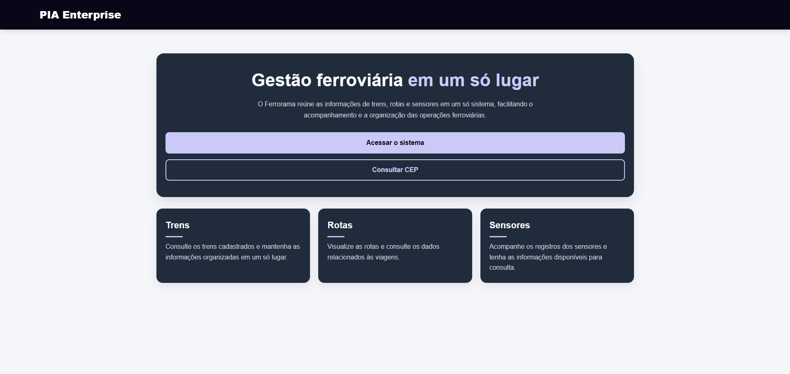

## 2. Como acessar o sistema

1. Ligue o computador que possui o sistema instalado.
2. Inicie o Apache e o MySQL pelo XAMPP.
3. Abra o navegador.
4. Acesse o endereço local configurado para a Ferrorama.
5. Aguarde o carregamento da página inicial.

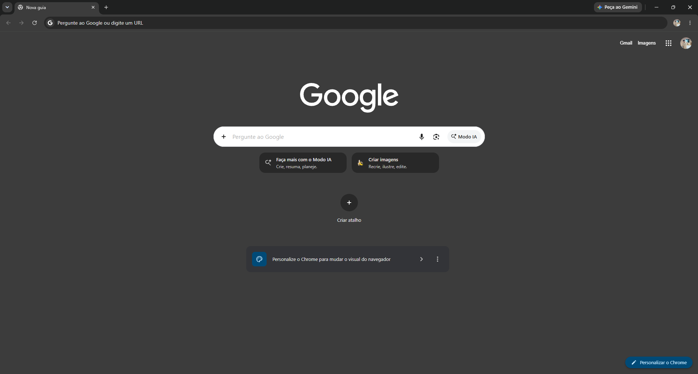

## 3. Como realizar login

1. Acesse a página de login.
2. Informe seu e-mail cadastrado.
3. Informe sua senha.
4. Clique no botão de entrar.
5. Após a autenticação, o sistema abrirá a área correspondente ao seu perfil.

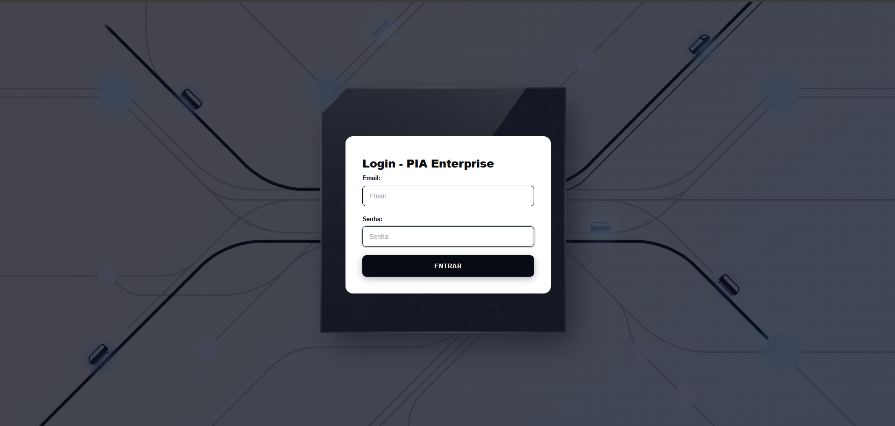

## 4. Perfis de acesso

A Ferrorama possui dois tipos de usuários:

### Administrador

Possui acesso às funcionalidades administrativas, incluindo gerenciamento de usuários, trens, rotas e sensores.

### Funcionário

Possui acesso às funcionalidades permitidas pelo sistema, sem acesso às operações exclusivas do administrador.

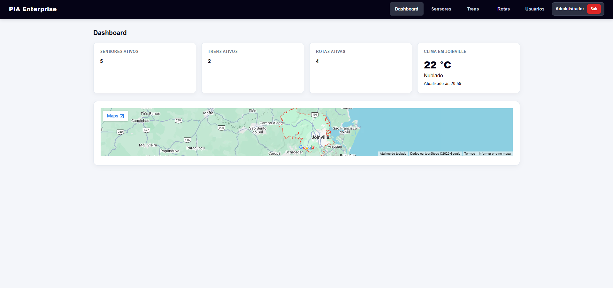

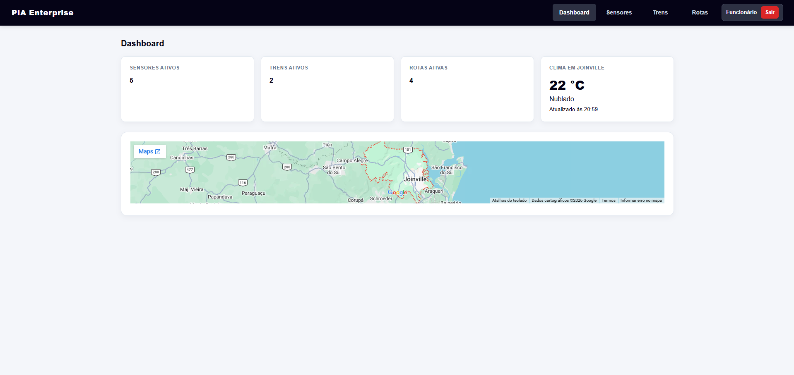

## 5. Navegação pelo sistema

O menu permite acessar as principais áreas:

- Dashboard
- Sensores
- Trens
- Rotas
- Usuários

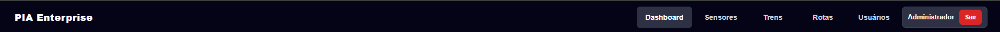

## 6. Gerenciamento de usuários

A área de usuários permite administrar as contas cadastradas.

### Cadastrar usuário

1. Acesse a área de usuários.
2. Clique em cadastrar novo usuário.
3. Informe o e-mail.
4. Informe a senha.
5. Selecione o tipo de usuário.
6. Clique em salvar.

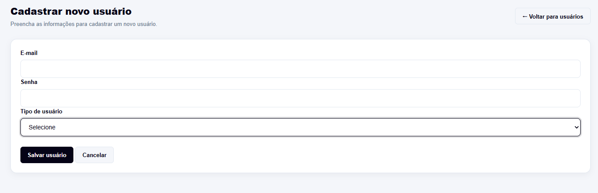

### Consultar usuários

Acesse a listagem para visualizar as contas cadastradas.

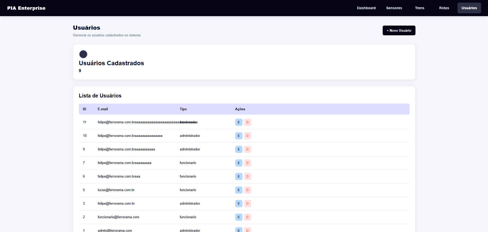

### Editar e excluir usuário

1. Localize o usuário desejado.
2. Selecione a opção de editar ou excluir.
3. Realize a operação conforme as informações apresentadas na tela.

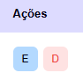

## 7. Gerenciamento de trens

A área de trens permite registrar e controlar as informações dos veículos ferroviários.

### Cadastrar trem

1. Acesse a área de trens.
2. Clique em novo trem.
3. Informe o nome.
4. Informe o modelo.
5. Informe a localização inicial.
6. Informe o código.
7. Informe a capacidade.
8. Informe o ano.
9. Selecione o status.
10. Selecione o usuário responsável, quando aplicável.
11. Salve o cadastro.

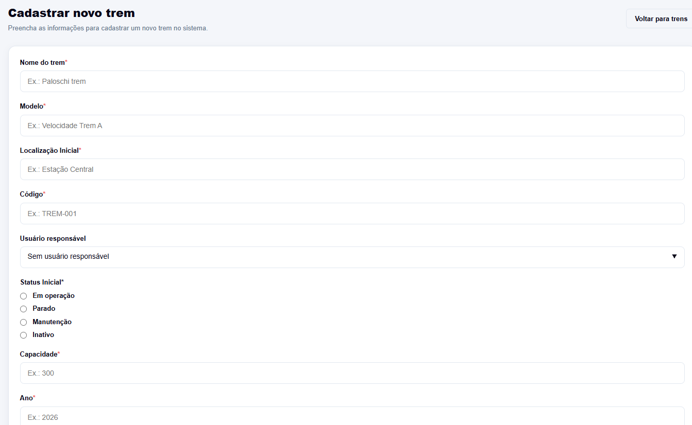

### Consultar trens

Acesse a listagem para visualizar os trens cadastrados.

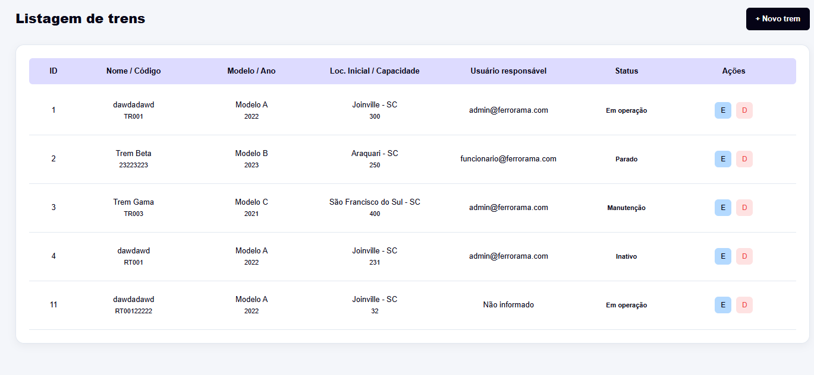

### Editar e excluir trem

1. Localize o trem.
2. Selecione editar ou excluir.
3. Realize a operação desejada.

Um trem que possui rota vinculada não pode ser excluído enquanto o relacionamento existir.

## 8. Gerenciamento de rotas

A área de rotas permite organizar os trajetos ferroviários.

### Cadastrar rota

1. Acesse a área de rotas.
2. Clique em nova rota.
3. Informe o nome.
4. Informe o modelo do trem.
5. Informe o tempo estimado.
6. Informe o código.
7. Informe a distância.
8. Selecione o status.
9. Associe um trem, caso necessário.
10. Salve o cadastro.

A associação com um trem é opcional.

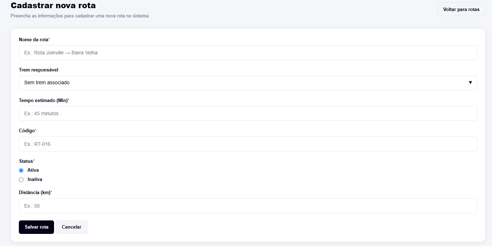

### Consultar rotas

Acesse a listagem para visualizar as rotas cadastradas.

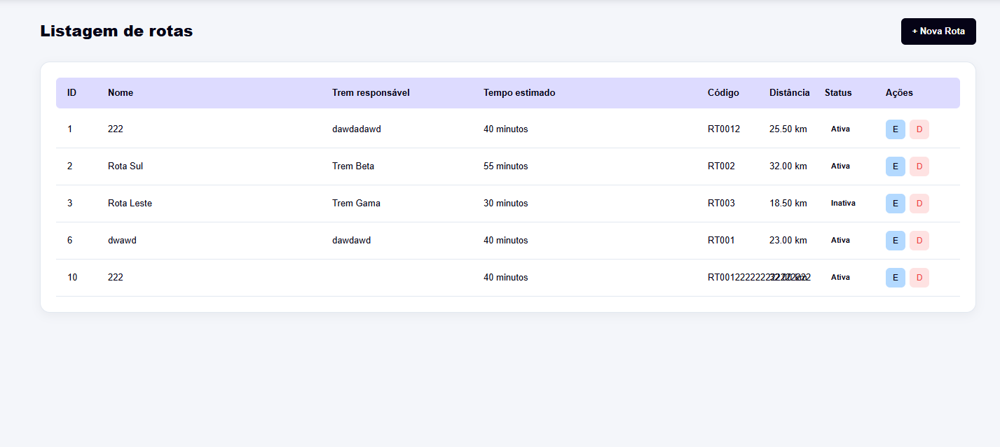

### Editar e excluir rota

1. Localize a rota.
2. Selecione editar ou excluir.
3. Realize a operação desejada.

Uma rota que possui sensores vinculados não pode ser excluída enquanto o relacionamento existir.

## 9. Gerenciamento de sensores

A área de sensores permite registrar equipamentos responsáveis pelo monitoramento ferroviário.

### Cadastrar sensor

1. Acesse a área de sensores.
2. Clique em novo sensor.
3. Informe o nome.
4. Selecione o tipo.
5. Informe a localização.
6. Associe uma rota, caso necessário.
7. Informe a unidade de medida.
8. Informe o limite de alerta.
9. Selecione o status inicial.
10. Preencha a descrição, quando solicitada.
11. Salve o cadastro.

A associação com uma rota é opcional.

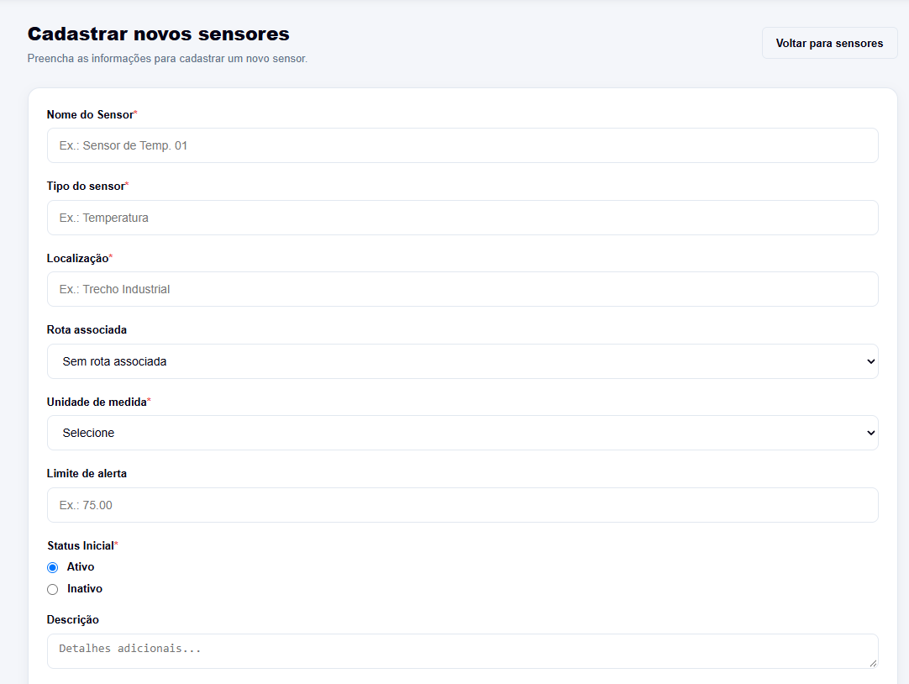

### Consultar sensores

Acesse a listagem para visualizar os sensores cadastrados e seus estados.

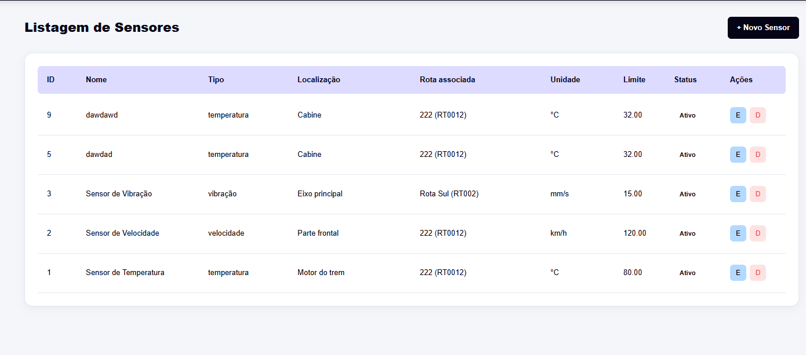

### Editar e excluir sensor

1. Localize o sensor.
2. Selecione editar ou excluir.
3. Realize a operação desejada.

## 10. Dashboard

O Dashboard apresenta informações gerais para facilitar o acompanhamento do sistema.

As informações podem incluir:

- Quantidade de sensores ativos.
- Quantidade de trens cadastrados.
- Quantidade de rotas cadastradas.
- Informações gerais de gerenciamento.

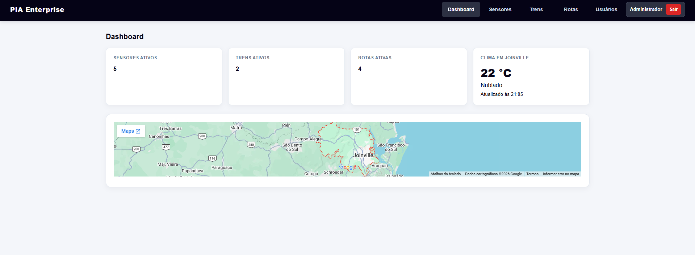

## 11. Como sair do sistema

1. Localize a opção de sair ou logout.
2. Clique nela.
3. Aguarde o encerramento da sessão.
4. O sistema retornará à tela de acesso.

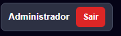

## 12. Considerações finais

A Ferrorama foi desenvolvida para centralizar o gerenciamento de informações ferroviárias em um único sistema.

Para utilizar corretamente a aplicação, respeite os campos obrigatórios, as permissões de acesso e as regras de relacionamento entre usuários, trens, rotas e sensores.
